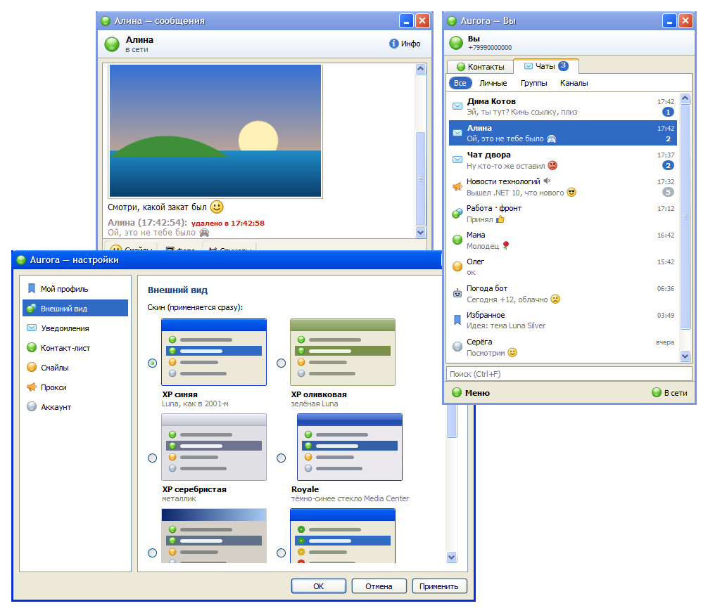
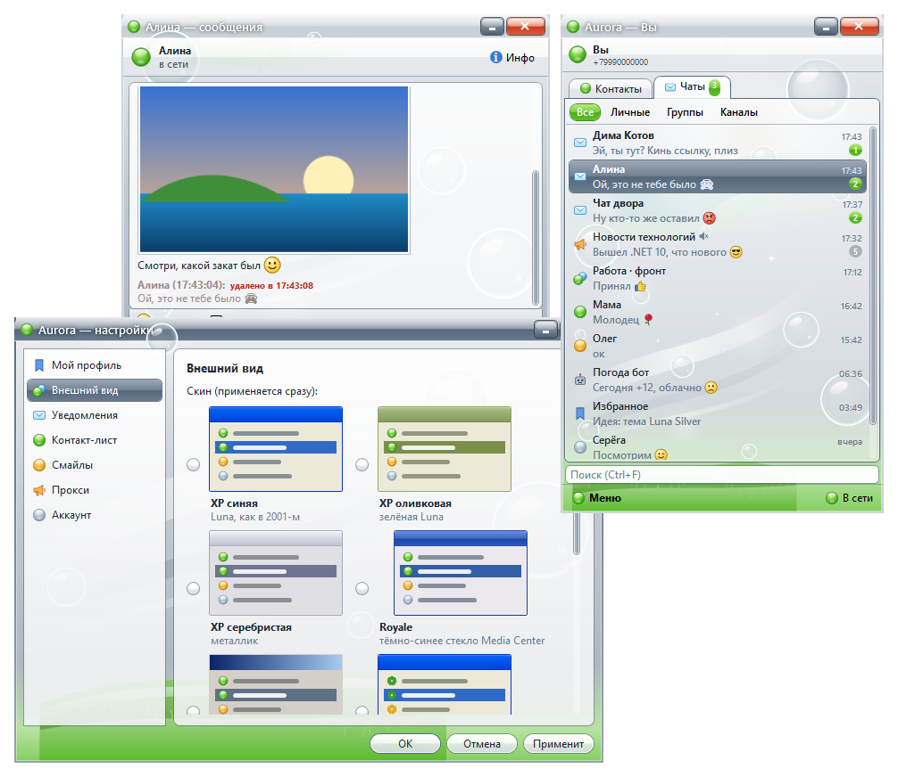
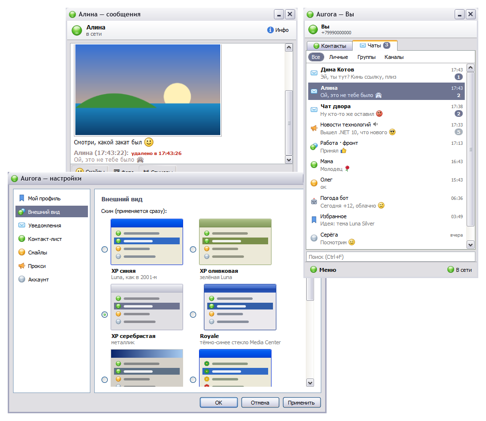
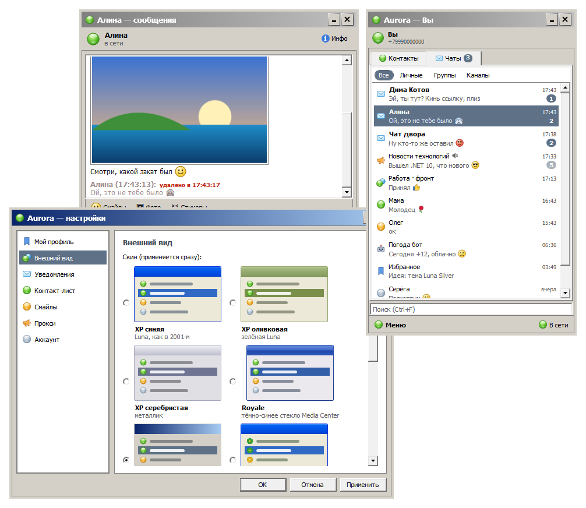
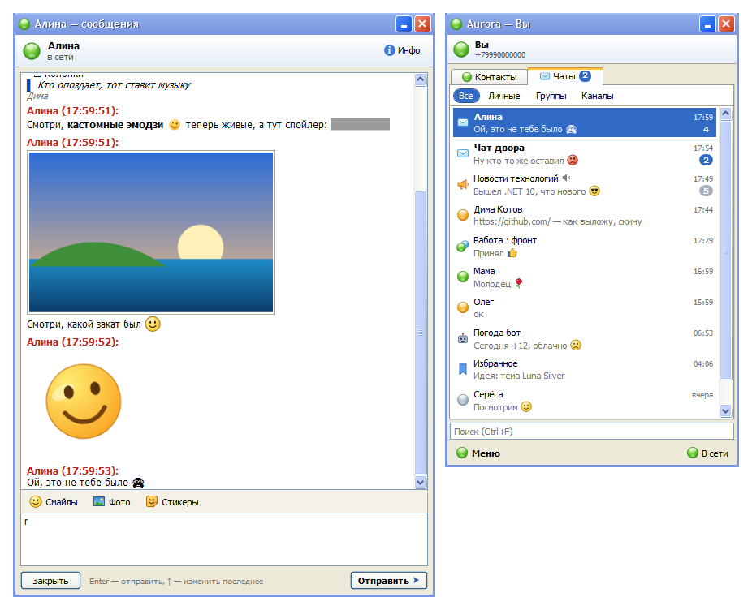

<div align="center">

# 🌼 Aurora

**Telegram, как в старые добрые.**

Открытый клиент Telegram для Windows в духе мессенджеров нулевых:
узкий контакт-лист, цветочки статусов, отдельное окно на каждую переписку, мигающий конверт и тот самый звук.

[**Скачать Aurora.exe**](https://github.com/traumadiv/aurora/releases/latest) · Windows 10/11 · один файл, без установки



</div>

## Скины

Семь скинов, переключаются на лету. У каждого свой цвет: выберите из палитры или задайте любой `#RRGGBB`.
Кнопки, вкладки и полосы прокрутки рисует сама Windows своими темами Luna, Royale и Classic, так что окна выглядят по-настоящему.

| | |
|:---:|:---:|
| <br>**Frutiger Aero**: стекло, пузыри, солнце и травка | <br>**XP серебристая** |
| <br>**Классика**: серый Windows 2000 | <br>**XP синяя** |

Ещё есть «XP оливковая», «Royale» с тёмно-синим стеклом Media Center и «ICQ 2003».

## Что умеет



**Переписка**
- Отдельное окно на каждый чат, история подгружается при прокрутке вверх
- «печатает…», галочки ✓/✓✓, кликабельные ссылки
- Фото: превью в чате, полный размер по клику. Отправка кнопкой, через `Ctrl+V` или перетаскиванием файла в окно
- Стикеры из ваших наборов Telegram: панель с недавними и всеми наборами. Анимированные стикеры проигрываются
- Кастомные эмодзи, жирный и курсив, спойлеры, код и цитаты, как в официальном клиенте
- Новые «насыщенные» сообщения Telegram с заголовками, списками, таблицами и цитатами
- Смайлы картинками вместо эмодзи и `:)` `;)` `:D` `<3`, можно поставить свой пак с GIF
- Правка своих сообщений: правый клик или `↑` в пустом поле

**Ничего не пропадёт**
- Если собеседник удалил сообщение, оно остаётся у вас с пометкой «удалено в 17:43»
- Если исправил, рядом появится «изм. ▾» со всеми прошлыми версиями
- Архив хранится только на вашем компьютере. Старые записи удаляются сами через выбранный срок: день, неделю, месяц, три месяца или год

**Как в ICQ**
- Вкладка «Контакты» с делением на «В сети» и «Не в сети», вкладка «Чаты» с фильтрами
- Статус цветком: зелёный в сети, жёлтый был недавно, красный давно не заходил
- Непрочитанное мигает конвертом в списке и в трее
- Режим «Невидимый», «Скрыть офлайн», «Поверх всех окон»
- Закрытие списка сворачивает Aurora в трей

**Язык**
- Русский и английский, выбирается в «Настройки → Язык / Language». По умолчанию берётся язык Windows
- Перевести на свой язык просто: скопируйте `src/Aurora/Lang/en.json`, переведите значения и пришлите PR

**Связь**
- Если у вас включён системный прокси или VPN, Aurora подхватит его сама
- MTProxy и SOCKS5: вставьте ссылку `tg://proxy?…` или `t.me/proxy?…` в «Настройки → Прокси»
- Вход по номеру, коду и облачному паролю

## Быстрее, чем кажется

Под капотом официальная библиотека [TDLib](https://github.com/tdlib/td) и нативный WPF на .NET 8, браузерного движка внутри нет.
Окно открывается мгновенно, чаты сначала берутся из локальной базы и уже потом синхронизируются с сервером.

## Клавиатура

| Где | Клавиши | Действие |
|---|---|---|
| Контакт-лист | просто печатайте | быстрый поиск |
| Контакт-лист | `Ctrl+F`, `↑` `↓`, `Enter` | поиск, выбор, открыть чат |
| Контакт-лист | `Ctrl+Tab` | «Контакты» ↔ «Чаты» |
| Контакт-лист | `Ctrl+P`, `Alt+M` | настройки, меню |
| Чат | `Enter` / `Shift+Enter` | отправить / перенос строки |
| Чат | `↑` в пустом поле | изменить последнее сообщение |
| Чат | `Ctrl+E` | смайлы |
| Чат | `Ctrl+V` | вставить картинку |
| Чат | `Esc`, `Ctrl+W` | закрыть окно |

## Установка

Скачайте `Aurora.exe` со страницы [Releases](https://github.com/traumadiv/aurora/releases) и запустите. .NET и TDLib уже внутри.

Exe пока не подписан, поэтому Windows может показать «Система Windows защитила ваш компьютер». Нажмите «Подробнее», затем «Выполнить в любом случае».

Посмотреть без аккаунта: `Aurora.exe --demo`.

Сессия, база TDLib и архив сообщений лежат только у вас, в `%APPDATA%\Aurora`.

## Сборка

Нужен [.NET 8 SDK](https://dotnet.microsoft.com/download/dotnet/8.0).

```bash
dotnet run -c Release --project src/Aurora
```

```powershell
./publish.ps1   # → dist\Aurora.exe
```

Сторонним клиентам Telegram нужны ключи API. Возьмите их на [my.telegram.org/apps](https://my.telegram.org/apps), скопируйте `src/Aurora/aurora.keys.example.props` в `aurora.keys.props` и впишите туда. Файл в `.gitignore`. Если собрать без ключей, Aurora спросит их при первом запуске.

Релизы собирает GitHub Actions: добавьте секреты `AURORA_API_ID` и `AURORA_API_HASH` и запушьте тег вида `v0.1.0`.

## Пока нет

Файлы и голосовые, видеостикеры (WebM показываются картинкой), ответы и реакции, папки чатов. PR приветствуются.

## Лицензия

MIT. TDLib распространяется под Boost Software License 1.0.
Aurora не связана с Telegram, ICQ или Microsoft. Их названия упоминаются только как стилистический ориентир.
